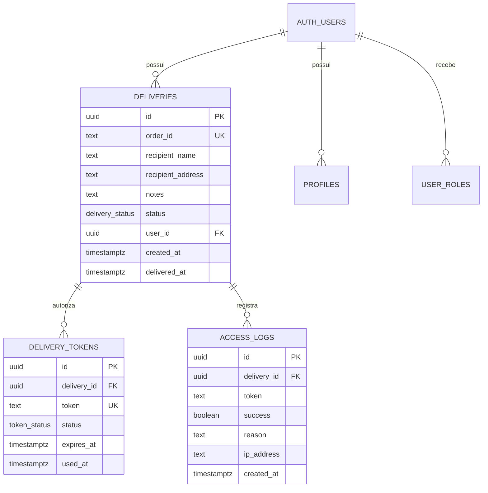
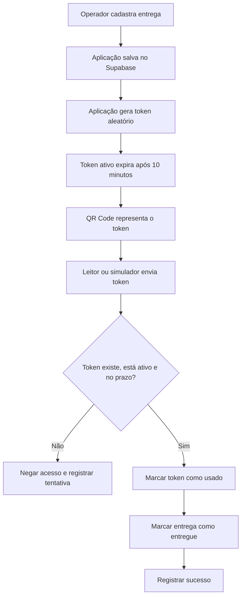
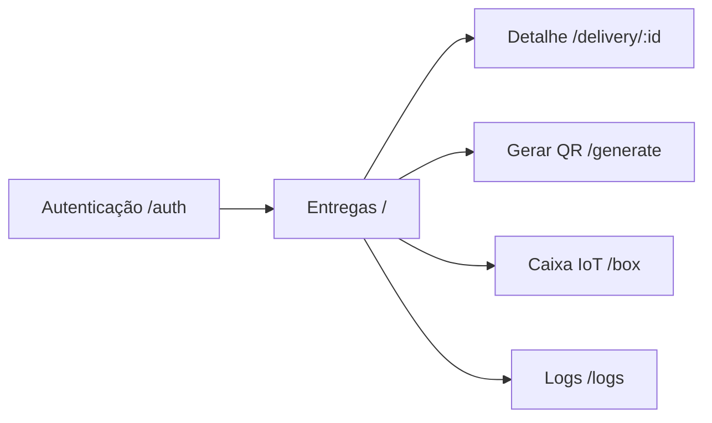

# PROJETO INTEGRADOR

## Smart Delivery Box: sistema de controle de entregas com QR Code e caixa inteligente

**Instituição:** Senac — [unidade a preencher]  
**Curso:** [nome do curso]  
**Turma:** [turma]  
**Integrantes:** [nomes completos]  
**Docente orientador(a):** [nome]  
**Local:** [município – UF]  
**Ano:** 2026

> **Versão de trabalho.** Este texto foi elaborado a partir da inspeção do código-fonte e das migrações de banco presentes no repositório. Os campos entre colchetes dependem de informações da equipe. Antes da entrega, conferir a versão vigente do guia/manual da biblioteca da unidade e as orientações do docente. O Senac São Paulo disponibiliza um Guia de Normalização e informa que ele serve como apoio; a instituição, unidade e curso deste grupo não foram identificados no projeto.

## Resumo

O Smart Delivery Box é um protótipo de aplicação web voltado ao registro e ao acompanhamento de entregas destinadas a uma caixa inteligente. A solução permite cadastrar entregas, consultar seus dados, gerar tokens temporários representados por QR Codes e registrar tentativas de validação. O repositório contém uma interface construída com React e TypeScript, serviços de persistência conectados ao Supabase, uma função de borda para validação de token e uma tela de simulação da caixa. O token gerado tem validade padrão de dez minutos e, no fluxo de validação implementado, pode ser consumido uma única vez para alterar o estado da entrega para “entregue”. A proposta busca organizar o processo de recebimento e reduzir a dependência de uma entrega presencial ao destinatário. O estado atual é de protótipo: há divergência entre o mecanismo de autenticação usado pela interface e o Supabase Auth esperado pelos serviços, e a integração física com fechadura e microcontrolador não está demonstrada no código analisado. Assim, os resultados descritos neste trabalho correspondem às funcionalidades identificadas no repositório, não a uma validação operacional em ambiente real.

**Palavras-chave:** entrega inteligente; QR Code; rastreamento; Internet das Coisas; aplicação web.

## 1 Introdução

### 1.1 Contextualização

O recebimento de encomendas exige coordenação entre entregador e destinatário. Quando não há alguém disponível no endereço, pode haver tentativa frustrada de entrega, necessidade de reagendamento ou exposição do pacote em local inadequado. Recursos digitais de identificação e registro podem apoiar esse processo, desde que sejam acompanhados de controles de acesso e de procedimentos seguros.

O Smart Delivery Box explora o uso de QR Code e de uma caixa inteligente como meios de autorizar e registrar a abertura de um compartimento. A aplicação mantém dados da entrega e emite um token que pode ser lido por um dispositivo de leitura ou pela simulação existente no sistema.

### 1.2 Problema ou oportunidade

O problema considerado é a dificuldade de receber encomendas quando o destinatário não está disponível, somada à necessidade de registrar a autorização e o resultado de cada tentativa de acesso. A oportunidade consiste em centralizar o cadastro da entrega e associar a ela uma credencial temporária, com registro de uso.

Esse problema é a motivação do projeto; o repositório não contém pesquisa de campo ou dados que quantifiquem sua frequência. A equipe deve acrescentar entrevistas, questionários ou fontes de mercado se quiser sustentar essa dimensão com evidências.

### 1.3 Solução proposta

A solução proposta é uma aplicação web responsiva para cadastrar e consultar entregas, emitir QR Codes com tokens temporários, validar os tokens e guardar logs de acesso. O projeto também inclui uma função Supabase Edge Function destinada à chamada de uma caixa/ESP32 e uma interface de simulação que valida o token pelo serviço de dados.

### 1.4 Organização do trabalho

Este documento apresenta a caracterização, justificativa e objetivos do projeto; os conceitos e tecnologias relacionados; seu alinhamento pedagógico e social; a descrição técnica dos requisitos, dados e fluxos; e, por fim, os resultados identificados, limitações, conclusão e possibilidades de evolução.

## 2 Descrição do Projeto

### 2.1 Caracterização

O Smart Delivery Box é um protótipo de sistema de informação para controle de entregas associado a uma caixa de recebimento inteligente. O produto combina uma interface web, armazenamento remoto no Supabase, leitura/geração de QR Code e uma função de validação preparada para receber solicitações de um dispositivo externo.

### 2.2 Público-alvo

O público potencial compreende operadores que registram encomendas, responsáveis por uma caixa de recebimento, entregadores autorizados a depositar pacotes e destinatários que precisam retirar encomendas. Esses perfis são uma definição de projeto; o código não implementa fluxos distintos para entregador e destinatário, nem apresenta pesquisa de validação com esses grupos.

### 2.3 Problema tratado

O sistema busca apoiar o registro de encomendas e permitir que uma autorização de abertura seja temporária, identificável e consumida uma vez. Ele não substitui a logística de transporte, não confirma a identidade física de quem retira o pacote e não comprova, por si só, a instalação ou a segurança física de uma caixa.

### 2.4 Escopo

**Incluído no protótipo:**

- cadastro de entrega com identificador do pedido, nome do destinatário, endereço opcional e observações;
- listagem, busca e filtro por estado de entregas;
- página de detalhes e consulta do QR Code ativo;
- geração de token e QR Code com expiração padrão de dez minutos;
- simulação de leitura/validação do QR Code;
- registro de tentativas de acesso e consulta de logs;
- função de borda `box-validate`, com autenticação por segredo de API no cabeçalho e atualização de token/entrega.

**Fora do escopo comprovado pelo repositório:**

- firmware funcional de ESP32, acionamento de servo/fechadura, instalação e testes de hardware;
- integração de pagamentos, transportadoras ou sistemas de comércio eletrônico;
- notificações por e-mail, SMS ou aplicativo;
- gestão de múltiplos endereços/caixas e configuração de permissões por perfil concluída;
- evidência de implantação de produção, testes com usuários ou operação em ambiente real.

## 3 Justificativa

O projeto é relevante como exercício de integração entre desenvolvimento web, persistência de dados, geração e leitura de QR Code e uma interface de serviço voltada a um dispositivo IoT. Para usuários e organizações, uma solução desse tipo pode facilitar a consulta do estado das entregas e produzir um histórico básico de tentativas de abertura. Para a equipe, permite aplicar conhecimentos de levantamento de requisitos, modelagem, programação, integração de serviços e documentação técnica.

Os benefícios são esperados, mas ainda não foram medidos. Não há no repositório levantamento de custo, estudo comparativo de mercado, pesquisa com usuários ou cálculo de redução de tentativas frustradas. Essas evidências devem ser produzidas pela equipe se forem exigidas pelo orientador.

## 4 Objetivo Geral

Desenvolver um protótipo de sistema para cadastrar e acompanhar entregas e controlar, por meio de tokens temporários representados por QR Code, a validação de acesso a uma caixa inteligente.

## 5 Objetivos Específicos

1. Modelar os dados de entregas, tokens de acesso e registros de validação.
2. Implementar uma interface para cadastrar e consultar entregas.
3. Gerar QR Codes associados a tokens únicos com prazo de expiração.
4. Implementar a validação de tokens e o registro de tentativas de acesso.
5. Disponibilizar uma simulação da validação e preparar um endpoint para integração com dispositivo IoT.
6. Identificar limitações técnicas e requisitos necessários para uma futura implantação segura.

## 6 Fundamentação Teórica

### 6.1 Sistemas de informação e rastreabilidade

Um sistema de informação organiza dados e operações para apoiar atividades de uma organização. Neste projeto, os registros de entrega, estado, token e log dão suporte à consulta do processo e à reconstrução de eventos básicos. O histórico disponível, contudo, é limitado aos dados que a aplicação persiste; não constitui rastreamento contínuo da localização do pacote.

### 6.2 QR Code e tokens

QR Code é uma representação bidimensional que pode ser lida por câmeras e aplicativos compatíveis. No protótipo, o QR Code codifica uma string aleatória criada com `crypto.randomUUID()`. O QR não contém, segundo o fluxo observado, os dados completos do destinatário; ele carrega o token usado para localizar e validar a autorização no banco.

O serviço define validade padrão de dez minutos e marca tokens anteriores ativos como expirados ao emitir outro para a mesma entrega. A validação verifica existência, prazo e estado de uso e, em caso de sucesso, registra o uso e marca a entrega como entregue. Uma autorização temporária reduz a janela prevista para reutilização, mas não comprova resistência a cópia, interceptação ou concorrência. A implementação deve ser submetida a revisão de segurança antes de uso real.

### 6.3 Internet das Coisas

Internet das Coisas (IoT) descreve sistemas em que dispositivos físicos se comunicam com serviços digitais para coletar informações ou executar ações. O código inclui uma função HTTP de validação e comentários que descrevem o uso pretendido por ESP32, mas não inclui firmware ou implementação verificada do acionamento físico. Portanto, a integração IoT é uma arquitetura planejada/prototipada, não um resultado de hardware demonstrado.

### 6.4 Tecnologias e conceitos de apoio

React organiza a interface em componentes; TypeScript acrescenta tipagem estática ao código; Vite fornece servidor de desenvolvimento e empacotamento. Supabase oferece serviços baseados em PostgreSQL, autenticação, políticas de acesso e funções de borda. React Query administra consultas e invalidações de cache no cliente. A biblioteca `qrcode.react` desenha QR Codes; `html5-qrcode` e `@capacitor-mlkit/barcode-scanning` aparecem no projeto para leitura em diferentes fluxos. Tailwind CSS e componentes Radix/shadcn compõem a camada visual.

### 6.5 Soluções semelhantes

O projeto se aproxima, em termos conceituais, de armários inteligentes para retirada de encomendas e sistemas de acesso por credencial temporária. Não foi identificada no repositório uma análise documentada de produtos concorrentes. Recomenda-se que a equipe escolha soluções reais, registre critérios comparáveis (custo, autenticação, notificações, disponibilidade e auditabilidade) e consulte as páginas oficiais dos fabricantes antes de afirmar diferenciais de mercado.

## 7 Alinhamento ao Modelo Pedagógico Senac

### 7.1 Perfil profissional de conclusão

O projeto pode contribuir para competências de análise de necessidades, modelagem e construção de sistemas, integração de tecnologias, resolução de problemas, comunicação técnica e avaliação de qualidade. A correspondência exata depende do curso e do Perfil Profissional de Conclusão vigente, que não constam dos arquivos fornecidos. A equipe deve transcrever ou referenciar os itens oficiais do plano de curso aplicáveis.

### 7.2 Marca Formativa

O trabalho permite relacionar a prática profissional à investigação de um problema, à colaboração, à inovação e à responsabilidade no desenvolvimento de uma solução digital. A redação final deve utilizar a formulação oficial da Marca Formativa e os indicadores adotados pelo curso/unidade, que precisam ser confirmados com o docente.

### 7.3 Objetivos de Desenvolvimento Sustentável

- **ODS 9 — Indústria, inovação e infraestrutura:** relação possível com a experimentação de uma infraestrutura digital e de um serviço conectado. É uma contribuição potencial e localizada, não evidência de impacto mensurado.
- **ODS 11 — Cidades e comunidades sustentáveis:** relação indireta com a busca por serviços urbanos de entrega mais organizados e acessíveis. A conexão precisa ser validada conforme o contexto de aplicação.
- **ODS 12 — Consumo e produção responsáveis:** o registro de tentativas pode apoiar melhor organização de recebimentos e reduzir retrabalho operacional em cenário de uso. O projeto não mediu redução de emissões, desperdício ou reentregas.

As relações com ODS devem ser apresentadas como alinhamentos pretendidos, sem afirmar que o protótipo já atingiu metas ou produziu impacto social comprovado.

## 8 Inovação e Diferencial Competitivo

O diferencial pretendido está na combinação, em um protótipo único, de gestão da entrega, credencial QR temporária, validação de uso único e registro de acessos, com uma função de borda destinada à comunicação com uma caixa IoT. Esse conjunto é uma integração de recursos conhecidos; não há busca de anterioridade, estudo de patente ou benchmarking no projeto que permita afirmar inovação inédita ou vantagem comercial comprovada.

## 9 Impacto no Mercado e/ou Sociedade

Em uma implantação validada, a solução poderia oferecer consulta mais organizada das entregas e um fluxo de retirada que não dependa da presença simultânea do destinatário. Operadores poderiam consultar registros de sucesso e falha. Para afirmar benefícios sociais, econômicos, de segurança ou ambientais, seriam necessários testes com usuários, métricas de operação, análise de acessibilidade e avaliação de riscos. Esses resultados ainda não estão documentados.

## 10 Viabilidade de Execução

### 10.1 Técnica

O protótipo usa ferramentas amplamente utilizadas e possui estrutura de cliente web, banco PostgreSQL gerenciado e função HTTP. A execução local exige Node.js e variáveis de ambiente do Supabase. Para concluir a viabilidade operacional, é necessário alinhar o fluxo de autenticação, configurar corretamente políticas e segredos, validar a função de borda e testar o hardware real, caso faça parte da entrega.

### 10.2 Econômica

Não foi encontrado orçamento, cotação de componentes ou estimativa de custos de hospedagem. A viabilidade econômica não pode ser concluída com as informações atuais. A equipe deve incluir custos de caixa/fechadura, microcontrolador, alimentação, conectividade, fabricação, hospedagem, manutenção e suporte, se aplicáveis.

### 10.3 Recursos necessários

- computador para desenvolvimento e navegador atualizado;
- Node.js/npm e dependências listadas no `package.json`;
- projeto Supabase com URL, chave pública e variáveis secretas da função;
- câmera compatível para leitura de QR Code;
- opcionalmente, ESP32, módulo de acionamento e caixa física para validar integração IoT;
- equipe, orientação docente e acesso ao manual acadêmico da unidade.

### 10.4 Cronograma resumido (proposta a ajustar)

| Etapa | Atividade | Período |
|---|---|---|
| 1 | Confirmar problema, público e requisitos com usuários/docente | [preencher] |
| 2 | Revisar autenticação, regras de acesso e modelo de dados | [preencher] |
| 3 | Finalizar interface e fluxo de geração/validação QR | [preencher] |
| 4 | Integrar e testar caixa física, se prevista | [preencher] |
| 5 | Executar testes, registrar resultados e corrigir falhas | [preencher] |
| 6 | Revisar documentação e normalização Senac | [preencher] |

## 11 Descrição Técnica

### 11.1 Levantamento de Requisitos

Os requisitos abaixo foram derivados das telas e dos serviços encontrados; devem ser validados pela equipe e pelo orientador.

#### Requisitos funcionais

| ID | Requisito | Situação observada |
|---|---|---|
| RF01 | Cadastrar uma entrega com identificador e nome do destinatário | Implementado na interface/serviço |
| RF02 | Registrar endereço e observações opcionais | Implementado |
| RF03 | Listar entregas e consultar detalhes | Implementado |
| RF04 | Buscar por identificador ou destinatário e filtrar status | Implementado |
| RF05 | Gerar token único e QR Code para uma entrega | Implementado no fluxo de serviço |
| RF06 | Definir prazo de expiração do token (padrão: dez minutos) | Implementado no serviço |
| RF07 | Validar token, rejeitando token inexistente, expirado ou usado | Implementado no simulador e previsto na função de borda |
| RF08 | Registrar resultado e motivo das tentativas de acesso | Implementado nos fluxos de validação |
| RF09 | Atualizar estado da entrega para “entregue” após validação aceita | Implementado no código de validação |
| RF10 | Consultar indicadores e histórico de logs | Implementado na tela de logs |
| RF11 | Autenticar usuário e proteger os dados por usuário | Parcial/inconsistente: UI usa API PHP local e `localStorage`; serviços usam usuário Supabase Auth e RLS |
| RF12 | Acionar fisicamente a fechadura após validação | Não demonstrado no código; função retorna resposta HTTP |

#### Requisitos não funcionais

| ID | Requisito | Observação |
|---|---|---|
| RNF01 | Interface web responsiva e navegável | Layout com componentes React/Tailwind; validar em dispositivos reais |
| RNF02 | Persistência de dados relacional | Tabelas PostgreSQL no Supabase |
| RNF03 | Restringir acesso aos dados por usuário/administrador | Há políticas RLS na migração posterior, mas precisam ser testadas com o fluxo de autenticação real |
| RNF04 | Tokens com validade temporal e uso único | Regras presentes no código; concorrência e atomicidade não estão comprovadas |
| RNF05 | Registrar data e resultado de acesso | Campos de data/hora, sucesso e motivo previstos no banco |
| RNF06 | Disponibilizar serviço de validação autenticado para caixa | Edge Function confere segredo `BOX_API_KEY`; segredo deve ser configurado fora do cliente |
| RNF07 | Usabilidade e acessibilidade | Não há avaliação ou conformidade documentada; requer testes |
| RNF08 | Compatibilidade com navegador/câmera e hardware | Deve ser validada nos dispositivos alvo |

### 11.2 Diagramas do Projeto

As figuras textuais abaixo são diagramas autorais derivados do esquema e do fluxo de código. Na versão formatada, numerar e legendar cada figura e referenciá-la no texto. Para o DER final, conferir com a instância Supabase efetivamente usada.

**Figura 1 — Diagrama entidade-relacionamento simplificado**

**Figura 2 — Fluxo de emissão e validação do token**

**Figura 3 — Mapa de navegação observado**

**UML:** não há diagrama UML existente no repositório. Um diagrama de casos de uso ou sequência pode ser elaborado a partir desses fluxos se o docente exigir.  
**Wireframes/mockups:** as telas foram implementadas no código, mas não foram fornecidas capturas de tela. Inserir imagens reais do protótipo, com nomes de figura, legendas e comentários, após executar a aplicação.

### 11.3 Ferramentas e Tecnologias Utilizadas

| Tecnologia | Uso identificado | Justificativa no projeto |
|---|---|---|
| React 18 | Interface por componentes | Organização de páginas e componentes reutilizáveis |
| TypeScript | Tipagem do código | Tipagem de dados e integrações no cliente |
| Vite | Desenvolvimento e build web | Servidor de desenvolvimento e empacotamento configurados |
| Supabase / PostgreSQL | Persistência, Auth, RLS, Realtime e função de borda | Backend remoto integrado ao cliente e às migrações |
| TanStack React Query | Consultas, cache e atualizações | Gerencia leituras e invalidação de consultas |
| React Router | Rotas | Navegação entre telas |
| `qrcode.react` | Geração visual de QR | Renderiza QR Code em SVG |
| `html5-qrcode` | Leitura QR via navegador | Usado pelo componente `QRScanner` |
| `@capacitor-mlkit/barcode-scanning` | Leitura QR em simulador/plataforma compatível | Usado pela tela da caixa simulada |
| Tailwind CSS, Radix UI e shadcn/ui | Estilo e controles de interface | Componentes visuais reutilizáveis |
| Framer Motion | Animações | Transições e estados visuais da interface |
| Node.js/npm | Ambiente de dependências e scripts | Scripts declarados em `package.json` |
| Supabase Edge Functions / Deno | Endpoint `box-validate` | Recebe token, verifica segredo e executa validação server-side |

O código também inclui Vitest e Testing Library como dependências e um teste de exemplo. A existência desses arquivos não comprova cobertura ou validação funcional abrangente.

### 11.4 Desenvolvimento da Solução

#### Arquitetura

O cliente SPA em React acessa tabelas Supabase usando `@supabase/supabase-js`. As páginas usam serviços encapsulados em `src/services/deliveryService.ts`; React Query coordena leituras e atualizações. As migrações definem tabelas, enums, índices, triggers e políticas RLS. A função `supabase/functions/box-validate/index.ts` é um endpoint server-side que usa a chave de serviço e segredo de caixa para validar um token.

#### Organização dos módulos

- `src/pages`: autenticação, listagem/detalhe de entrega, geração QR, simulador, logs e página não encontrada;
- `src/components`: layout, proteção de rota, scanner e formulário de entrega;
- `src/services`: operações de entrega, token e logs;
- `src/integrations/supabase`: cliente e tipos do banco;
- `src/hooks`: estado de autenticação e hooks auxiliares;
- `supabase/migrations`: esquema e políticas do banco;
- `supabase/functions/box-validate`: validação para integração externa.

#### Fluxo de funcionamento

O operador cadastra uma entrega ou usa o formulário de geração rápida. A aplicação grava os dados e cria um token aleatório com expiração. O QR Code exibe esse token. O leitor o envia ao validador. Se o token existir, não estiver expirado e ainda não tiver sido usado, o fluxo marca token e entrega como utilizados/entregues e registra o acesso; caso contrário, retorna falha e registra o motivo.

Há dois caminhos de validação no repositório: `BoxSimulator` chama a validação cliente-side via Supabase; a Edge Function realiza a validação server-side prevista para ESP32. A tela `ScanQR` chama a função, porém fixa uma chave de API diretamente no código cliente. Isso não deve ser tratado como configuração segura para produção; a chave deve ser rotacionada se ainda estiver ativa e mantida exclusivamente em dispositivo/servidor controlado, nunca publicada no bundle web.

### 11.5 Principais Telas da Aplicação

As descrições a seguir vêm do código. Inserir capturas verdadeiras antes da entrega acadêmica.

1. **Autenticação (`/auth`)** — apresenta abas para login e cadastro. O código envia requisições a endpoints PHP em `localhost`; esse backend não está no repositório analisado.
2. **Entregas (`/`)** — lista, busca por identificador/nome, filtra por estado e abre formulário de novo registro.
3. **Detalhe (`/delivery/:id`)** — exibe dados e estado da entrega, QR ativo, contagem regressiva, regeneração e opção de download do QR.
4. **Gerar QR (`/generate`)** — cria entrega e token e mostra o QR. O botão “Download QR” está visualmente presente, mas não possui ação implementada no código observado; há ação de impressão.
5. **Simulador da caixa (`/box`)** — lê QR com o plugin Capacitor e mostra estados de validação, caixa aberta ou acesso negado.
6. **Logs (`/logs`)** — apresenta total de registros, sucessos e falhas e uma lista cronológica resumida.

### 11.6 Principais Trechos do Código-Fonte

Trechos a selecionar na versão final, sem reproduzir arquivos completos:

- `generateToken` em `src/services/deliveryService.ts`: criação de UUID, prazo de dez minutos e substituição dos tokens ativos anteriores;
- `validateToken` no mesmo serviço: verificação de existência, expiração e uso, atualização da entrega e registro de log;
- handler POST em `supabase/functions/box-validate/index.ts`: validação da chave da caixa e execução server-side;
- políticas RLS nas migrações Supabase: delimitação de acesso a entregas associadas a usuários.

Ao inserir excertos, remover quaisquer segredos/chaves, comentar sua função e citar o caminho do arquivo. O código completo deve permanecer no repositório ou ser disponibilizado como material complementar conforme solicitado pelo curso.

## 12 Resultados Obtidos

### 12.1 Funcionalidades identificadas

O código contém páginas e serviços para cadastro, listagem, detalhe, geração de QR/token, simulador de validação e consulta de logs. As migrações declaram tabelas de entregas, tokens, logs, perfis e papéis; políticas de acesso; e publicação de tabelas para Realtime. A Edge Function implementa uma rota de validação com segredo de API.

### 12.2 Objetivos alcançados e limitações

Os objetivos de prototipação da interface e de implementação do fluxo básico estão representados no código. Não foi possível confirmar funcionamento integrado, pois esta documentação não executou a aplicação, não acessou o Supabase configurado e não testou hardware. Também foram observadas limitações relevantes:

- autenticação híbrida inconsistente: a UI usa endpoints PHP locais e `localStorage`, enquanto operações de criação usam `supabase.auth.getUser()` e as políticas RLS exigem usuário Supabase;
- `ScanQR.tsx` contém um segredo de API embutido no código cliente; verificar imediatamente se é um segredo real e rotacioná-lo, mantendo o segredo somente em configuração segura;
- a validação do simulador é cliente-side e suas atualizações encadeadas não são atômicas; a Edge Function também não verifica erros de todas as operações nem usa transação/consumo atômico;
- no esquema/migração revisados, o acesso do leitor à função está preparado, mas os testes de autorização e de concorrência não foram encontrados;
- o botão de download da tela `/generate` aparenta não executar ação;
- o componente de scanner web `QRScanner` aparece na página `ScanQR`, mas essa página não foi incluída nas rotas do `App.tsx`;
- a interface de log solicita todos os registros permitidos ao usuário, sem paginação visível;
- não há código de firmware/hardware no repositório analisado;
- não há evidências de ensaios, resultados de testes, métricas ou avaliação por usuários.

Essas observações são revisão estática do código, não resultado de teste de penetração ou auditoria formal.

### 12.3 Testes

O projeto declara scripts `test` (Vitest), `lint` e `build`, e contém um teste de exemplo. Não foram executados para esta documentação. A seção de resultados deve ser atualizada pela equipe com comandos, ambiente, casos testados, resultados e evidências reais; não declarar testes aprovados sem executá-los.

## 13 Conclusão

O Smart Delivery Box apresenta uma proposta de controle de entregas que associa cadastro digital a uma credencial QR temporária e a um histórico de tentativas. A estrutura do repositório demonstra um protótipo web com persistência Supabase e uma função preparada para validar tokens em uma integração externa. A proposta atende ao objetivo de representar tecnicamente o fluxo essencial, mas sua prontidão para uso real ainda depende da correção do fluxo de autenticação, da proteção de segredos, da validação das políticas e da execução de testes integrados. A integração física, os benefícios para usuários e o impacto operacional permanecem sem comprovação experimental.

## 14 Implementações Futuras

1. Unificar login, sessão e logout com Supabase Auth e remover dependência dos endpoints PHP locais, ou documentar e versionar formalmente o backend correspondente.
2. Remover segredo exposto do cliente e rotacioná-lo se estiver ativo; estabelecer armazenamento seguro e autenticação apropriada do dispositivo.
3. Tornar o consumo do token atômico no servidor, prevenindo duas validações simultâneas bem-sucedidas.
4. Revisar e testar todas as políticas RLS com contas de usuário e administrador.
5. Adicionar paginação aos logs, busca/filtros necessários e tratamento consistente de falhas.
6. Implementar a ação de download QR e decidir se o scanner web deve ser roteado ou removido.
7. Desenvolver firmware e integração física, incluindo tratamento de falha de rede, confirmação do acionamento e segurança elétrica/mecânica.
8. Criar testes automatizados de regras de token, autenticação, permissões e integração; conduzir testes de usabilidade e acessibilidade.
9. Realizar pesquisa com público-alvo, comparação com soluções existentes e estimativa de custos.
10. Produzir documentação de implantação, configuração de variáveis e operação sem expor credenciais.

## 15 Referências Bibliográficas

As páginas técnicas devem ser consultadas em suas versões vigentes na data de entrega. Ajustar a formatação ao manual da unidade.

- SENAC SÃO PAULO. **Guia de normalização de trabalhos acadêmicos**. Disponível em: <https://www3.sp.senac.br/hotsites/campus_santoamaro/cd/arquivos/biblioteca/guia_normatizacao.pdf>. Acesso em: 4 nov. 2026.
- SENAC SÃO PAULO. **Biblioteca Senac São Paulo**. Disponível em: <https://www.sp.senac.br/jsp/default.jsp?newsID=a18511.htm&testeira=386>. Acesso em: 4 nov. 2026.
- UNITED NATIONS. **The 17 Goals**. Disponível em: <https://sdgs.un.org/goals>. Acesso em: 4 nov. 2026.
- REACT. **React: The library for web and native user interfaces**. Disponível em: <https://react.dev/>. Acesso em: 4 nov. 2026.
- MICROSOFT. **TypeScript Documentation**. Disponível em: <https://www.typescriptlang.org/docs/>. Acesso em: 4 nov. 2026.
- VITE. **Vite: Next Generation Frontend Tooling**. Disponível em: <https://vite.dev/guide/>. Acesso em: 4 nov. 2026.
- SUPABASE. **Supabase Documentation**. Disponível em: <https://supabase.com/docs>. Acesso em: 4 nov. 2026.
- SUPABASE. **Row Level Security**. Disponível em: <https://supabase.com/docs/guides/database/postgres/row-level-security>. Acesso em: 4 nov. 2026.
- SUPABASE. **Edge Functions**. Disponível em: <https://supabase.com/docs/guides/functions>. Acesso em: 4 nov. 2026.
- DENSO WAVE. **What is a QR Code?** Disponível em: <https://www.qrcode.com/en/about/>. Acesso em: 4 nov. 2026.
- SMART DELIVERY BOX. **Código-fonte do projeto**. Repositório local: diretório `Smart-event/Smart-event`. [Informar endereço do repositório remoto, se público ou autorizado para consulta]. Acesso em: 4 nov. 2026.

> **Nota de referência:** confirmar se a edição atual do manual Senac indicada pelo docente continua sendo o guia PDF acima. A página institucional consultada descreve um guia de normalização voltado principalmente a trabalhos do Centro Universitário; cursos técnicos podem receber orientações próprias.

## 16 Apêndices

### Apêndice A — Dados e estados principais

| Entidade | Campos principais | Estados relevantes |
|---|---|---|
| Entrega | ID, pedido, destinatário, endereço, notas, estado, usuário, datas | `pending`, `in_transit`, `ready_for_pickup`, `delivered`, `failed` |
| Token de entrega | ID, entrega, token, expiração, criação, uso | `active`, `used`, `expired` |
| Log de acesso | ID, entrega (opcional), token, sucesso, motivo, IP, data | sucesso/falha |

### Apêndice B — Itens para completar pela equipe

- preencher unidade, curso, turma, integrantes, docente e município;
- confirmar problema e público-alvo com evidências, se exigido;
- validar objetivos e ODS com orientador;
- executar testes e preencher resultados reais;
- adicionar capturas comentadas e diagramas finais exportados;
- confirmar hardware, orçamento e cronograma;
- atualizar link do repositório remoto;
- revisar normalização e referências segundo o manual vigente.

## 17 Anexos

Não foram incluídos anexos externos neste arquivo. Acrescentar, se necessário e autorizado, normas, manuais de hardware, licenças e documentos de terceiros utilizados na implementação.
